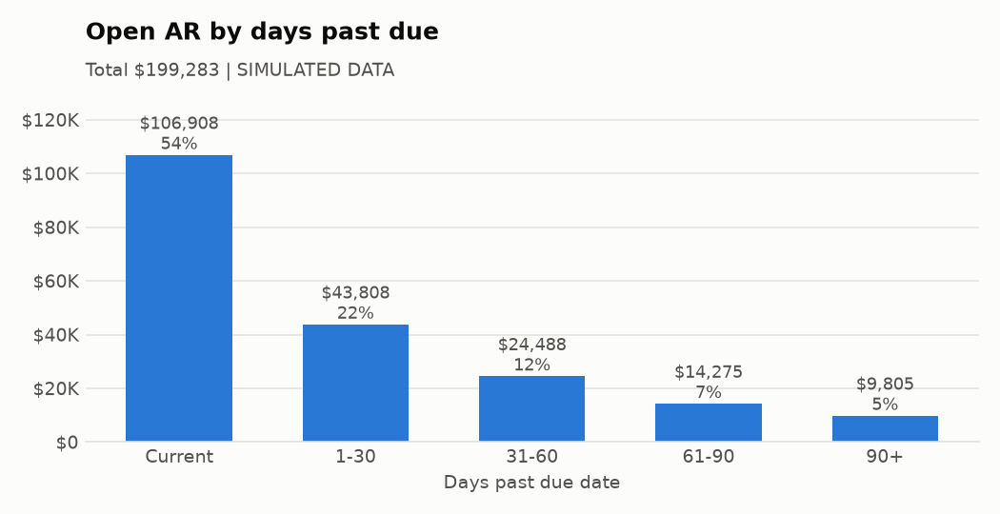
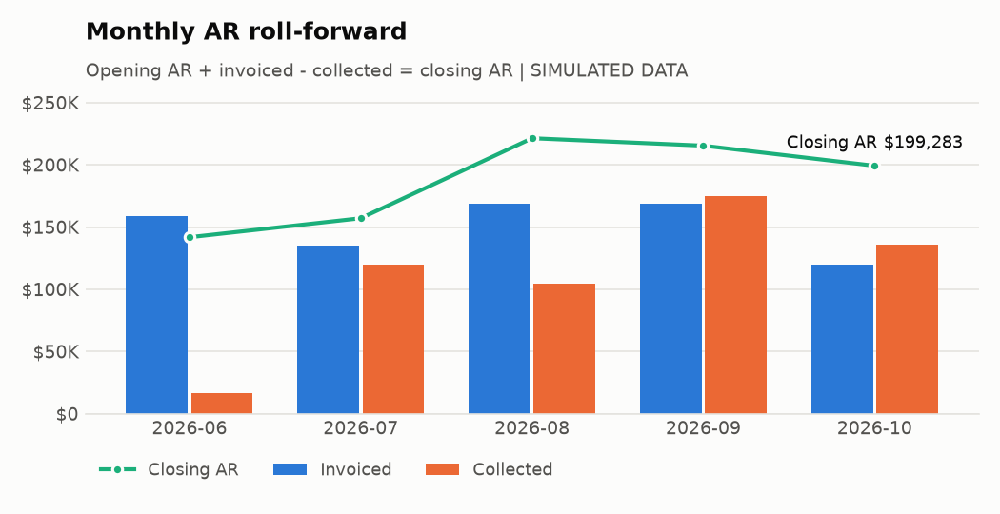
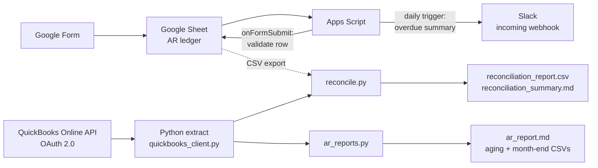
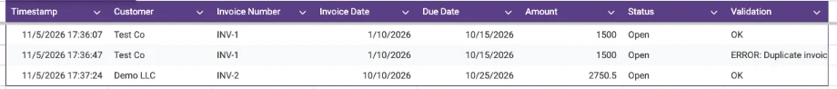
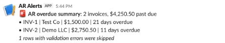

# Invoice Tracking Automation

[](https://github.com/vmtri15/invoice-tracking-automation/actions/workflows/tests.yml)

A small accounts receivable (AR) automation project. Invoices are logged through a Google Form,
validated and chased automatically, reconciled against QuickBooks Online, and summarized in
month-end AR reports.

> **No real company data is in this repo.** `data/sample/` and the top-level files in `reports/` are
> SIMULATED (from `src/generate_sample_data.py`). `reports/sandbox_run/` comes from Intuit's sandbox
> sample company plus test invoices entered through the Form.

## The business problem (a controller's view)

- **AR** is money customers owe us. Every day it goes unpaid ties up cash. Overdue invoices need to be chased early, because the longer an invoice ages, the less likely it is to be collected.
- Here, invoices are logged in **two places**: a team spreadsheet (fast, easy for anyone to use) and **QuickBooks** (the general ledger, which feeds the financial statements). The two drift apart through typos, forgotten entries, double entries, and payments recorded in one place but not the other.
- At **month-end close** the controller needs to know: does the AR we report tie out? How much was invoiced and collected this month? How old is the open balance? Which differences need fixing before the books close?

This project automates those checks:

| Step | What it does | Where |
|---|---|---|
| Intake | Google Form writes each invoice to a Google Sheet (the AR ledger) | Google Forms/Sheets |
| Validation | Each new row is checked for missing fields, duplicate invoice numbers and amount ≤ 0 | `apps_script/Code.gs` |
| Overdue alerts | Every morning, unpaid invoices past their due date are posted to Slack | `apps_script/Code.gs` |
| Extract | Invoices and payments are pulled from the QuickBooks Online API (OAuth 2.0) into CSV | `src/quickbooks_client.py` |
| Reconciliation | Sheet vs QuickBooks: missing on either side, amount differences, status differences, duplicates | `src/reconcile.py` |
| Reporting | AR aging (Current / 1-30 / 31-60 / 61-90 / 90+), month-end AR roll-forward, DSO, collection rate, allowance for doubtful accounts, charts | `src/ar_reports.py`, `src/charts.py` |
| Quality | 16 pytest tests plus a full mock pipeline run on every push (GitHub Actions) | `tests/`, `.github/workflows/` |





*(Charts from the simulated data. Live sandbox charts are in [reports/sandbox_run/charts](reports/sandbox_run/charts/).)*

## Key AR metrics (what the report adds for a controller)

| Metric | Formula | Simulated result (Oct 2026) |
|---|---|---|
| DSO (days sales outstanding) | closing AR / invoiced in the month × days in the month | 51.5 days |
| Collection rate | collected / (opening AR + invoiced) | 40.6% |
| Past due share | balance 1+ days past due / total open AR | 46.4% |
| Allowance for doubtful accounts | sum of each aging bucket × a reserve rate (1%, 3%, 10%, 25%, 50%) | $13,303.23 |
| Net realizable AR | gross AR − allowance | $185,979.94 |

The report also proposes the month-end entry: **Dr Bad Debt Expense / Cr Allowance for Doubtful Accounts**.
The reserve rates are illustrative; a real company sets them from its own write-off history.

## Architecture



## Quick start (mock mode, no accounts needed)

```bash
make setup     # creates .venv with Python 3.12 and installs requirements.txt
make run       # full pipeline on simulated data
make test      # pytest
```

Without `make`: `python3.12 -m venv .venv && .venv/bin/pip install -r requirements.txt && .venv/bin/python -m src.run_pipeline`.

Then open [`reports/reconciliation_summary.md`](reports/reconciliation_summary.md) and [`reports/ar_report.md`](reports/ar_report.md).

On the sample data, the reconciliation finds exactly the 25 problems that were planted
(`data/sample/simulated_planted_problems.csv`; a test checks this), and closing AR in the
month-end roll-forward ties to the aging total.

## Live results (real Google, Slack and QuickBooks sandbox, Nov 5 2026)

The same code, run against the real services instead of mock files. The QuickBooks
data is Intuit's sandbox sample company; the Sheet rows are test invoices entered through the Form.

**Validation on form submit:** the second INV-1 entry is flagged as a duplicate within seconds.



**Daily overdue alert in Slack:** unpaid invoices past due, with the error row excluded so it isn't counted twice.



**Reconciliation, Sheet vs QuickBooks sandbox** ([full reports](reports/sandbox_run/)):

| Result | Invoice | What it means |
|---|---|---|
| Clean match | 1037 Sonnenschein Family Store | same amount, both Open |
| STATUS_MISMATCH, $2,369.52 | 1004 Cool Cars | Sheet says Open but QuickBooks shows it paid: AR overstated, risk of chasing a customer who already paid |
| DUPLICATE_IN_SHEET, $1,500.00 | INV-1 | double form submission |
| MISSING_IN_QB, $4,250.50 | INV-1, INV-2 | test invoices never booked in the GL |
| MISSING_IN_SHEET, $7,402.55 | 29 invoices | in QuickBooks but not tracked by the team |

AR aging: $5,281.52 open, 71% current, nothing 90+. The month-end roll-forward closing AR **ties** to the aging total.
October DSO 39.9 days, collection rate 41.2%, allowance $134.51, net realizable AR $5,147.01.

## Project layout

```
apps_script/Code.gs        Form validation + daily Slack alert (paste into the Sheet's Apps Script editor)
apps_script/appsscript.json
src/common.py              paths and small helpers
src/generate_sample_data.py  SIMULATED data with planted problems (fixed seed)
src/quickbooks_client.py   QuickBooks API extract (live) or sample JSON (mock) -> data/extracted/*.csv
src/reconcile.py           matching rules + reconciliation report
src/ar_reports.py          aging, month-end roll-forward, DSO, collection rate, allowance
src/charts.py              aging and AR trend charts (PNG)
src/run_pipeline.py        one command for the whole pipeline
.github/workflows/         CI: tests + mock pipeline on every push
data/sample/               SIMULATED inputs
reports/                   outputs (the committed copies come from simulated data)
tests/                     hand-checked examples and edge cases
```

## Reconciliation rules

Records are matched on invoice number, with spaces trimmed and case ignored. Each exception row gets an **amount at risk**:

| Exception | Meaning | Amount at risk |
|---|---|---|
| `DUPLICATE_IN_SHEET` | Same invoice number entered twice; the first entry is used for matching | the copy's amount (it overstates AR) |
| `MISSING_IN_QB` | In the Sheet, not in QuickBooks: maybe never billed in the GL | sheet amount |
| `MISSING_IN_SHEET` | In QuickBooks, not in the Sheet: the team isn't tracking it | QuickBooks amount |
| `AMOUNT_MISMATCH` | Different amounts | absolute difference |
| `STATUS_MISMATCH` | Sheet says Paid but QB has a balance, or Sheet says Open but QB is paid | QB balance, or sheet amount |
| `MISSING_INVOICE_NUMBER` | Sheet row with no number | sheet amount |

QuickBooks has no "status" field. Status is worked out from `Balance`: 0 means Paid, a balance below the total means Partially Paid, and the full total means Open. A partial payment counts as "not paid", so a Sheet status of Open agrees with it.

## Setup for the real thing

### 1. Google Form → Sheet
1. Create a Google Form with these questions (all required): **Customer** (short answer), **Invoice Number** (short answer), **Invoice Date** (date), **Due Date** (date), **Amount** (short answer, with a "number > 0" response validation rule), **Status** (multiple choice: Open, Paid).
2. Responses tab → **Link to Sheets** → create a new spreadsheet. The tab is called `Form Responses 1`, and the column headers match the question titles, which is what the script expects.

### 2. Slack incoming webhook
1. Go to https://api.slack.com/apps → **Create New App** → *From scratch*, and pick your workspace.
2. **Incoming Webhooks** → turn it on → **Add New Webhook to Workspace** → choose a channel (for example `#ar-alerts`).
3. Copy the webhook URL. Treat it like a password: anyone who has it can post to that channel.

### 3. Apps Script + triggers
1. In the Sheet: **Extensions → Apps Script**. Replace the default code with `apps_script/Code.gs`. Optionally, turn on "Show appsscript.json" in Project Settings and paste in the manifest.
2. **Project Settings → Script properties → Add**: `SLACK_WEBHOOK_URL` = your webhook URL. This keeps the URL out of the code.
3. In the editor, pick `installTriggers` and click **Run**, then approve the permissions. This creates:
   - an installable **on form submit** trigger → `onFormSubmit`
   - a **daily time-driven** trigger (8 to 9 am) → `dailyOverdueAlert`
4. Test it: submit the Form twice with the same invoice number. The second row should get `ERROR: Duplicate invoice number` in the new **Validation** column. Then run `dailyOverdueAlert` by hand to check the Slack post.

### 4. Intuit Developer sandbox (QuickBooks Online)
1. Sign up at https://developer.intuit.com. A **sandbox company** with sample data is created for you (Dashboard → Sandbox).
2. Create an app with the **Accounting** scope. Under **Keys and credentials (Development)**, copy the Client ID and Client Secret. Add the redirect URI `https://developer.intuit.com/v2/OAuth2Playground/RedirectUrl`.
3. Open the **OAuth 2.0 Playground** (https://developer.intuit.com/app/developer/playground), select your app and the `com.intuit.quickbooks.accounting` scope, authorize the sandbox company, and exchange the code for tokens. Copy the **Refresh Token** and the **Realm ID**.
4. Run `cp .env.example .env` and fill in `QBO_CLIENT_ID`, `QBO_CLIENT_SECRET`, `QBO_REFRESH_TOKEN` and `QBO_REALM_ID`.
5. Export the Google Sheet (File → Download → CSV) and run:
   ```bash
   .venv/bin/python -m src.run_pipeline --live --sheet path/to/ledger.csv
   ```
   The script exchanges the refresh token for a 1-hour access token, pages through `select * from Invoice` and `select * from Payment`, and saves any rotated refresh token back to `.env`. Sandbox refresh tokens expire after about 100 days without use; get a new one from the Playground if that happens. Live output goes to `reports/live/` (git-ignored), so the simulated reports are never overwritten.

### 5. Live Google Sheet read (optional, replaces the CSV export)
1. In https://console.cloud.google.com create a project, then **APIs & Services → Library → Google Sheets API → Enable**.
2. **IAM & Admin → Service Accounts → Create service account** (no roles needed). Open it → **Keys → Add key → JSON**. Save the file as `secrets/google-service-account.json` (the `secrets/` folder is git-ignored).
3. Copy the service account's email (`...@...iam.gserviceaccount.com`). In your Sheet, click **Share**, paste it, choose **Viewer**.
4. In `.env`, set `GOOGLE_SHEET_ID` (the part of the Sheet URL between `/d/` and `/edit`).
5. Run without `--sheet`:
   ```bash
   .venv/bin/python -m src.run_pipeline --live
   ```
   The script asks Google for read-only access and reads the `Form Responses 1` tab exactly as displayed.

Troubleshooting, all seen during setup: *"Service account key creation is disabled"* means the project sits under a Google Cloud organization with Secure-by-Default policies; use a project with "No organization". A `403 ... API has not been used` means the Sheets API is off in *that* project. A `403 The caller does not have permission` means the Sheet isn't shared with the service account yet.

Secrets live only in `.env`, `secrets/` (both git-ignored) and in Apps Script Script Properties.

## Accounting notes: the journal entries behind the data

QuickBooks posts these entries automatically. The Sheet is only a tracking list and never touches the general ledger.

| Event | Debit | Credit | Effect on AR |
|---|---|---|---|
| Invoice issued for $1,000 | Accounts Receivable 1,000 | Sales Revenue 1,000 | AR up 1,000 |
| (if sales tax applies) | Accounts Receivable | Sales Tax Payable | |
| Customer pays in full | Cash / Undeposited Funds 1,000 | Accounts Receivable 1,000 | AR down to 0 |
| Partial payment of $600 | Cash 600 | Accounts Receivable 600 | 400 stays open and keeps aging |
| Correct an over-billed invoice (credit memo $100) | Sales Returns & Allowances 100 | Accounts Receivable 100 | AR down 100 |
| Reserve for doubtful accounts (e.g. a % of the 90+ bucket) | Bad Debt Expense | Allowance for Doubtful Accounts | net AR down; gross AR unchanged |
| Write off an uncollectible invoice | Allowance for Doubtful Accounts | Accounts Receivable | gross AR down |

How the reconciliation maps to fixes:
- *Missing in QB*: the revenue and AR were never booked. Create the invoice in QuickBooks, or confirm the Sheet row is invalid.
- *Status mismatch, Sheet Paid / QB open*: either the payment was never recorded in the GL (record it: Dr Cash, Cr AR), or the cash never arrived (correct the Sheet and follow up with the customer).
- *Amount mismatch*: compare against the source document (contract or PO). A credit memo or corrected invoice fixes QuickBooks; an edit fixes the Sheet.
- *Duplicate*: delete the extra Sheet row so AR isn't counted twice.

The month-end roll-forward is the standard AR rollforward: **opening AR + invoiced − collected = closing AR**. Closing AR must tie to the aging total; the report prints that tie-out.
