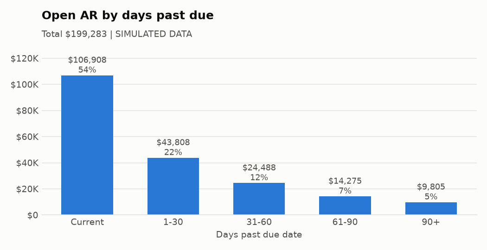
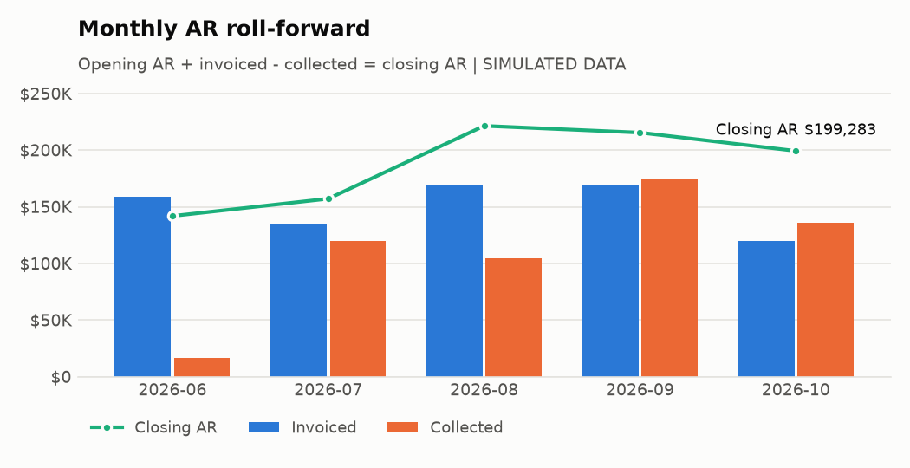

# AR report as of 2026-10-31

> **SIMULATED DATA.** These numbers come from generated sample data (src/generate_sample_data.py), not from a real company.

## Key metrics

| Metric | Value |
|---|---|
| Gross open AR | $199,283.17 |
| Past due (1+ days) | $92,375.53 (46.4%) |
| Allowance for doubtful accounts | $13,303.23 |
| Net realizable AR | $185,979.94 |
| DSO, 2026-10 | 51.5 days |
| Collection rate, 2026-10 | 40.6% |

## AR aging (open balances, days past due date)

| bucket | invoices | balance | pct_of_total |
|---|---|---|---|
| Current | 29 | 106,907.64 | 53.6 |
| 1-30 | 20 | 43,807.70 | 22.0 |
| 31-60 | 7 | 24,488.31 | 12.3 |
| 61-90 | 4 | 14,274.70 | 7.2 |
| 90+ | 6 | 9,804.82 | 4.9 |

**Total open AR: $199,283.17**

## Top 5 customers by open balance

| customer | Current | 1-30 | 31-60 | 61-90 | 90+ | Total |
|---|---|---|---|---|---|---|
| Eastgate Foods | 32,796.98 | 2,629.53 | 2,632.82 | 6,191.00 | 0.00 | 44,250.33 |
| Summit Cycle Shop | 18,654.81 | 1,201.16 | 0.00 | 0.00 | 2,007.87 | 21,863.84 |
| Redwater Brewing | 4,510.23 | 9,432.15 | 0.00 | 2,915.46 | 0.00 | 16,857.84 |
| Tidewater Textiles | 8,490.03 | 0.00 | 0.00 | 3,243.65 | 793.59 | 12,527.27 |
| Bluebird Dental Group | 2,081.38 | 2,071.03 | 4,357.65 | 0.00 | 3,779.58 | 12,289.64 |

## Month-end summary (AR roll-forward)

| month | opening_ar | invoiced | collected | closing_ar | collection_rate_pct | dso_days |
|---|---|---|---|---|---|---|
| 2026-06 | 0.00 | 158,521.10 | 16,670.12 | 141,850.98 | 10.5 | 26.8 |
| 2026-07 | 141,850.98 | 134,808.14 | 119,553.10 | 157,106.02 | 43.2 | 36.1 |
| 2026-08 | 157,106.02 | 169,046.02 | 104,749.36 | 221,402.68 | 32.1 | 40.6 |
| 2026-09 | 221,402.68 | 168,935.16 | 174,904.22 | 215,433.62 | 44.8 | 38.3 |
| 2026-10 | 215,433.62 | 120,039.85 | 136,190.30 | 199,283.17 | 40.6 | 51.5 |

Tie-out: closing AR $199,283.17 vs aging total $199,283.17: **ties**.

DSO = closing AR / invoiced in the month x days in the month. Collection rate = collected / (opening AR + invoiced).

## Allowance for doubtful accounts (aging method)

| bucket | balance | reserve_rate_pct | allowance |
|---|---|---|---|
| Current | 106,907.64 | 1.0 | 1,069.08 |
| 1-30 | 43,807.70 | 3.0 | 1,314.23 |
| 31-60 | 24,488.31 | 10.0 | 2,448.83 |
| 61-90 | 14,274.70 | 25.0 | 3,568.68 |
| 90+ | 9,804.82 | 50.0 | 4,902.41 |

Reserve rates are illustrative assumptions, not company history. Proposed month-end entry (assuming the allowance starts at zero):

| Account | Debit | Credit |
|---|---|---|
| Bad Debt Expense | 13,303.23 | |
| Allowance for Doubtful Accounts | | 13,303.23 |
