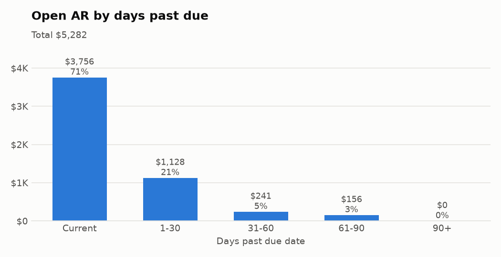
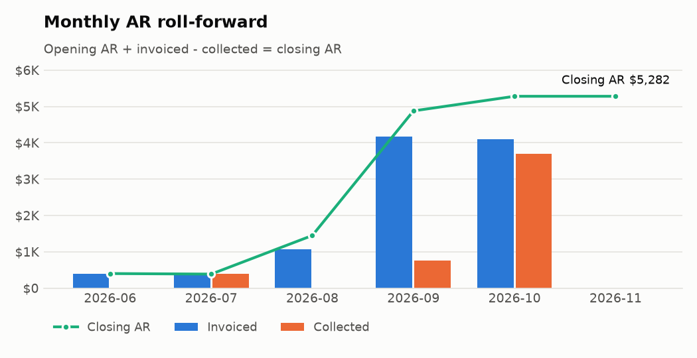

# AR report as of 2026-11-05

## Key metrics

| Metric | Value |
|---|---|
| Gross open AR | $5,281.52 |
| Past due (1+ days) | $1,525.50 (28.9%) |
| Allowance for doubtful accounts | $134.51 |
| Net realizable AR | $5,147.01 |
| DSO, 2026-10 | 39.9 days |
| Collection rate, 2026-10 | 41.2% |

## AR aging (open balances, days past due date)

| bucket | invoices | balance | pct_of_total |
|---|---|---|---|
| Current | 10 | 3,756.02 | 71.1 |
| 1-30 | 6 | 1,128.50 | 21.4 |
| 31-60 | 3 | 241.00 | 4.6 |
| 61-90 | 1 | 156.00 | 3.0 |
| 90+ | 0 | 0.00 | 0.0 |

**Total open AR: $5,281.52**

## Top 5 customers by open balance

| customer | Current | 1-30 | 31-60 | 61-90 | 90+ | Total |
|---|---|---|---|---|---|---|
| Paulsen Medical Supplies | 954.75 | 0.00 | 0.00 | 0.00 | 0.00 | 954.75 |
| Geeta Kalapatapu | 629.10 | 0.00 | 0.00 | 0.00 | 0.00 | 629.10 |
| 0969 Ocean View Road | 477.50 | 0.00 | 0.00 | 0.00 | 0.00 | 477.50 |
| John Melton | 0.00 | 450.00 | 0.00 | 0.00 | 0.00 | 450.00 |
| Travis Waldron | 414.72 | 0.00 | 0.00 | 0.00 | 0.00 | 414.72 |

## Month-end summary (AR roll-forward)

| month | opening_ar | invoiced | collected | closing_ar | collection_rate_pct | dso_days |
|---|---|---|---|---|---|---|
| 2026-06 | 0.00 | 401.75 | 0.00 | 401.75 | 0.0 | 30.0 |
| 2026-07 | 401.75 | 387.00 | 401.75 | 387.00 | 50.9 | 31.0 |
| 2026-08 | 387.00 | 1,062.40 | 0.00 | 1,449.40 | 0.0 | 42.3 |
| 2026-09 | 1,449.40 | 4,181.42 | 751.80 | 4,879.02 | 13.4 | 35.0 |
| 2026-10 | 4,879.02 | 4,101.57 | 3,699.07 | 5,281.52 | 41.2 | 39.9 |
| 2026-11 | 5,281.52 | 0.00 | 0.00 | 5,281.52 | 0.0 | n/a |

Tie-out: closing AR $5,281.52 vs aging total $5,281.52: **ties**.

DSO = closing AR / invoiced in the month x days in the month. Collection rate = collected / (opening AR + invoiced).

## Allowance for doubtful accounts (aging method)

| bucket | balance | reserve_rate_pct | allowance |
|---|---|---|---|
| Current | 3,756.02 | 1.0 | 37.56 |
| 1-30 | 1,128.50 | 3.0 | 33.85 |
| 31-60 | 241.00 | 10.0 | 24.10 |
| 61-90 | 156.00 | 25.0 | 39.00 |
| 90+ | 0.00 | 50.0 | 0.00 |

Reserve rates are illustrative assumptions, not company history. Proposed month-end entry (assuming the allowance starts at zero):

| Account | Debit | Credit |
|---|---|---|
| Bad Debt Expense | 134.51 | |
| Allowance for Doubtful Accounts | | 134.51 |
